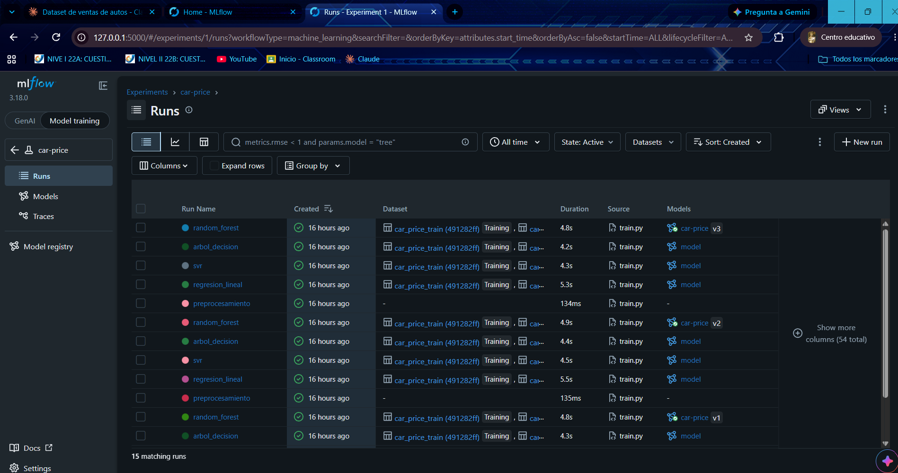
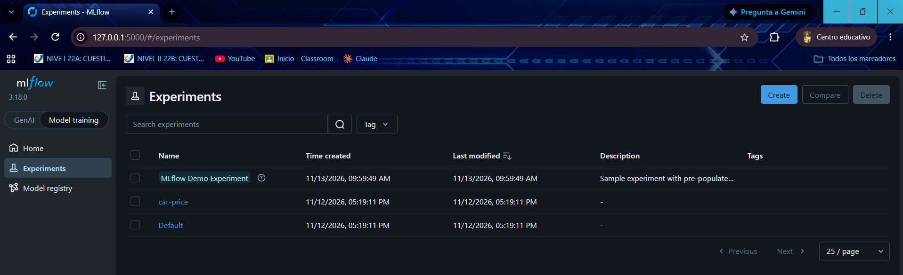
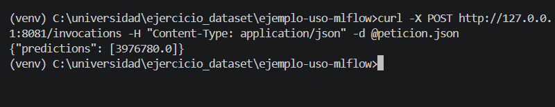
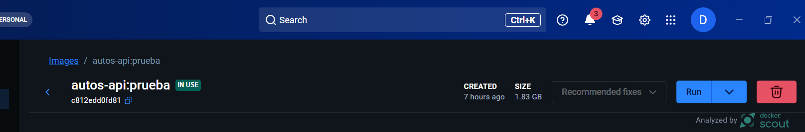

# ejemplo-uso-mlflow

Flujo con MLflow: limpiar el conjunto de autos usados, entrenar cuatro regresores, registrar el de mayor R2 con el alias `challenger` y servir ese regresor para predecir `Price`. El artefacto `model` es solo el estimador. La API recibe las 18 columnas ya codificadas y escaladas. Los filtros, el mapa del `LabelEncoder` y la media y la escala quedan en el run `preprocesamiento`.

Dataset: [Vehicle dataset from CarDekho](https://www.kaggle.com/datasets/nehalbirla/vehicle-dataset-from-cardekho), archivo `car details v4.csv`.

Los nombres del experimento, del modelo y del alias salen de `.env` (`MLFLOW_EXPERIMENT_NAME`, `MLFLOW_MODEL_NAME`, `MLFLOW_MODEL_ALIAS`). En esta copia son `car-price` y `challenger`.

## Estructura

```
├── README.md                 # este documento
├── requirements.txt          # librerías del proyecto
├── .env.example              # variables de ejemplo, sin secretos
├── .gitignore                # mlflow.db, mlruns/, venv/ y .env
├── MLproject                 # mlflow run . --env-manager local
├── notebooks/
│   └── 01_exploracion.ipynb  # explorar y prototipar
├── src/
│   ├── config.py             # experimento, modelo y semilla
│   ├── data.py               # limpiar, codificar, escalar y partir
│   ├── train.py              # entrenar y dejar el regresor en MLflow
│   ├── register.py           # mejor run → alias challenger
│   ├── predict.py            # predecir con columnas ya transformadas
│   └── ejemplo_api.py        # documento de petición y respuesta
├── ejemplos-api/             # generado: un Markdown por modelo y alias
├── data/                     # car_details_v4.csv, fuera de Git
├── mlflow.db                 # generado: parámetros, métricas, versiones
└── mlruns/                   # generado: modelos y artefactos
```

`mlflow.db` y `mlruns/` no están en el repositorio. MLflow los crea al entrenar o al abrir la interfaz.

## Instalar

Requisitos: Python 3.12 y Docker, si se va a construir la imagen.

En Windows (CMD):

```
python -m venv venv
venv\Scripts\activate
pip install -r requirements.txt
copy .env.example .env
```

En Linux o macOS:

```bash
python3 -m venv venv
source venv/bin/activate
pip install -r requirements.txt
cp .env.example .env
```

`.env` es local. No lo subas a Git.

## Datos

`data/` guarda el conjunto de trabajo. `DATA_PATH` es `data/car_details_v4.csv` y ese archivo no se sube a Git. Para descargarlo:

```
python -c "import kagglehub,shutil,os; p=kagglehub.dataset_download('nehalbirla/vehicle-dataset-from-cardekho'); shutil.copy(os.path.join(p,'car details v4.csv'),'data/car_details_v4.csv')"
```

La política está en `data/README.md`.

## Interfaz y almacén

Desde la raíz del proyecto, con el entorno activado. Esta terminal se queda ocupada:

```
mlflow ui --host 127.0.0.1 --port 5000 --backend-store-uri sqlite:///mlflow.db
```

La interfaz queda en http://127.0.0.1:5000. Lee `sqlite:///mlflow.db` y los archivos de `mlruns/`. El entrenamiento y el servicio van en otra terminal.

## Entrenar

`src/train.py` abre un run `preprocesamiento` y, después, un run por regresor: regresión lineal, SVR, árbol de decisión y random forest. Cada uno guarda R2, MAE, RMSE, parámetros y el estimador.

```
python src/train.py
```

También con MLflow (en Linux o macOS, carga antes `.env` con `set -a && source .env && set +a`):

```
mlflow run . --env-manager local
```

`--env-manager local` reutiliza el entorno ya instalado. Sin esa opción MLflow intenta crear otro entorno con pyenv.

## Registrar el challenger

`src/register.py` elige el run terminado con mayor `r2` y publica ese modelo con el alias `challenger`.

```
python src/register.py
```

O con MLflow:

```
mlflow run . -e register --env-manager local
```

Predicción y servicio usan `models:/car-price@challenger`, no un número de versión fijo. Cada ejecución crea una versión nueva y mueve el alias a ella.

El pipeline completo (entrenar, registrar y predecir):

```
mlflow run . -e pipeline --env-manager local
```

## Servir el modelo

`mlflow models serve` expone el regresor. La petición lleva una fila ya codificada y escalada. Una fila produce un solo precio.

```
mlflow models serve -m "models:/car-price@challenger" --port 5001 --env-manager local
```

El servicio escucha en http://127.0.0.1:5001. Para regenerar el ejemplo de esa versión:

```
python src/ejemplo_api.py --modelo car-price --alias challenger --puerto 5001
```

Eso escribe `ejemplos-api/car-price__challenger.md`, con la petición `curl` de una fila (las 18 columnas: `Make`, `Year`, `Kilometer`, `Fuel Type`, `Transmission`, `Location`, `Color`, `Owner`, `Seller Type`, `Engine`, `Max Power`, `Max Torque`, `Drivetrain`, `Length`, `Width`, `Height`, `Seating Capacity`, `Fuel Tank Capacity`). La petición tiene esta forma:

```bash
curl http://127.0.0.1:5001/invocations \
  -H 'Content-Type: application/json' \
  -d '{"dataframe_split": {"columns": ["Make", "Year", "Kilometer", "Fuel Type", "Transmission", "Location", "Color", "Owner", "Seller Type", "Engine", "Max Power", "Max Torque", "Drivetrain", "Length", "Width", "Height", "Seating Capacity", "Fuel Tank Capacity"], "data": [[27.0, 1.3711022487994868, 0.20732558308095356, 2.0, 0.0, 10.0, 15.0, 1.0, 2.0, 1.8607320207527467, 0.8317672324834471, 1.5684174136644837, 0.0, 1.2117207830060008, 0.6825560927588246, 1.8424428745351773, 2.123895946466629, 1.9742626685803497]]}}'
```

La respuesta tiene esta forma:

```json
{ "predictions": [3976780.0] }
```

`src/predict.py` hace lo mismo en local, sin levantar el servicio:

```
python src/predict.py
```

O con MLflow:

```
mlflow run . -e predict --env-manager local
```

## Imagen Docker

`mlflow models build-docker` empaqueta el alias `challenger`. Dentro del contenedor el proceso escucha en el puerto 8080.

```bash
mlflow models build-docker \
  -m "models:/car-price@challenger" \
  -n "tu_usuario_dockerhub/mi-modelo-challenger:latest"
```

Para probarla en el puerto 5002 del equipo:

```bash
docker run --rm -p 5002:8080 tu_usuario_dockerhub/mi-modelo-challenger:latest
```

La misma fila, contra el contenedor (cambia solo el puerto a 5002):

```bash
curl http://127.0.0.1:5001/invocations \
  -H 'Content-Type: application/json' \
  -d '{"dataframe_split": {"columns": ["Make", "Year", "Kilometer", "Fuel Type", "Transmission", "Location", "Color", "Owner", "Seller Type", "Engine", "Max Power", "Max Torque", "Drivetrain", "Length", "Width", "Height", "Seating Capacity", "Fuel Tank Capacity"], "data": [[27.0, 1.3711022487994868, 0.20732558308095356, 2.0, 0.0, 10.0, 15.0, 1.0, 2.0, 1.8607320207527467, 0.8317672324834471, 1.5684174136644837, 0.0, 1.2117207830060008, 0.6825560927588246, 1.8424428745351773, 2.123895946466629, 1.9742626685803497]]}}'
```

`--rm` borra el contenedor al detenerlo con Ctrl+C.

## Cargar imagen a Docker Hub

```bash
docker login

mlflow models build-docker \
  -m "models:/car-price@challenger" \
  -n "tu_usuario_dockerhub/mi-modelo-challenger:latest"

docker push tu_usuario_dockerhub/mi-modelo-challenger:latest
```

Sustituye `tu_usuario_dockerhub` por el usuario de Docker Hub. Si la imagen ya se construyó en el paso anterior, basta con `docker login` y `docker push`.

## Resultados

Partición 70 % entrenamiento y 30 % prueba, semilla 42.

| Modelo           | R2    | MAE     |
| ---------------- | ----- | ------- |
| regresion_lineal | 0.698 | 564,489 |
| svr              | 0.683 | 472,783 |
| arbol_decision   | 0.762 | 362,255 |
| random_forest    | 0.899 | 249,159 |

`random_forest` es el modelo registrado como `challenger`.

## Qué no se versiona

| Ruta         | Motivo                                               |
| ------------ | ---------------------------------------------------- |
| `.env`       | valores locales; puede llegar a tener secretos       |
| `venv/`      | entorno de Python                                    |
| `mlflow.db`  | metadatos generados: parámetros, métricas, versiones |
| `mlruns/`    | archivos generados: modelos y artefactos             |
| `data/*.csv` | el conjunto de datos se descarga, no se sube         |

## Capturas

### 1. Runs y métricas en MLflow



### 2. Model Registry con el alias challenger



### 3. API respondiendo



### 4. Imagen Docker


